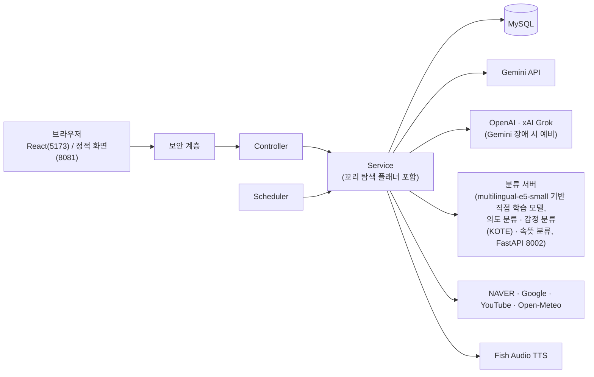

# Lumi(개인 비서)

감정을 읽고, 놓친 일정을 먼저 짚어주고, 개인 데이터를 안전하게 지키는 **개인 AI 비서**입니다.
동양미래대학교 컴퓨터소프트웨어공학과 「인공지능프로젝트」(2026년 2학기) 개별 프로젝트이며, 「정보보안개론」에서 배운 보안 원칙을 실제 서비스에 적용했습니다.

**배포 주소**: https://lumi.lenovatio.me (구글 로그인 지원)

## 왜 만들었나

| 겪은 불편 | Lumi의 해결 |
| --- | --- |
| 일정이 겹치는 걸 마감 직전에야 발견 | 일정을 등록할 때 겹침을 계산해서 먼저 알려줌 |
| 일정·메모·검색이 여러 앱에 흩어짐 | 한 화면에서 대화로 조회·등록·검색 |
| 코딩 중 검색하느라 흐름이 끊김 | 대화창에서 바로 검색 결과를 요약해서 받음 |
| 기존 음성 비서가 기계적임 | 위트 있는 친구 말투, 감정에 맞춰 톤 조절 |
| 개인 프로젝트는 보안이 뒷전 | 인증·입력 검증·AI 특유의 위협 대응을 설계에 포함 |
| 갑작스러운 교통 정체와 대중교통 지연 때문에 등굣길에 지각함 (택시를 타고도 늦거나, 지하철을 여러 번 갈아타고 돌아간 적이 있음) | 선제 알림(현재 구현)에 더해, 날씨·검색 질문에 이어 경로·교통 변수를 추가로 파고드는 꼬리 탐색(Deep Dive)의 등교 체인으로 확장 구현 |

## 주요 기능

- **감정 인식 대화**: Gemini가 친구 같은 말투로 대화하고, 직접 학습한 감정 분류 모델이 메시지의 감정을 분석해 답변 톤을 조절합니다. 대화 내용은 저장하지 않고 감정 수치만 기록합니다.
- **의도 분류기 — 도구 선택 힌트**: 문장을 9개 의도로 분류하는 직접 학습 모델이 Gemini Function Calling보다 먼저 돌아 "이 도구일 것" 힌트를 제공합니다(외부 API 호출 없이 수십 ms). 명령형 문장이면 감정 분석을 중립 처리하는 명령 게이트로도 쓰입니다. 확신이 낮으면 최종 도구 선택은 그대로 Gemini에게 맡깁니다.
- **상대방 말의 속뜻 분석**: 카카오톡·문자 등 상대방이 보낸 문장을 넣으면, 겉으로 드러난 뜻과 다른 실제 속마음(서운함·떠보기·비꼼·압박 등)을 직접 학습한 분류 모델로 추정합니다.
- **꼬리 탐색(Deep Dive)**: 답변 후 모델 호출 없는 규칙 기반 플래너가 대화를 더 파고들지 판단해, 개념 설명(구성→풀이→원리→더 알아보기), 날씨(예보→추이→대기질→AI 해석), 등교 경로(경로 비교→교통 변수) 체인을 카드로 이어 보여줍니다. 개인정보·명령 문장과 인사말은 건너뜁니다.
- **Function Calling 도구 9개**: 일정 조회·등록(겹침 감지), 리마인더 조회·등록, 노트 저장·삭제, 네이버 웹 검색, 구글 검색, 유튜브 검색
- **선제 알림**: 1분마다 임박한 일정·리마인더를 확인해 Lumi가 먼저 말을 겁니다.
- **음성 대화**: 브라우저 음성 인식(STT)과 Fish Audio 음성 출력(TTS). 실패하면 브라우저 음성합성으로 자동 대체합니다.
- **답변 교차 검증**: 사용자가 요청할 때만, 직전 답변을 네이버/구글 검색 결과와 대조합니다.
- **설정**: 입력 언어, AI 답변 언어, 음성 성별
- **대시보드**: Gemini 7일 사용량, 7일 감정 추이, 일정·리마인더·메모 패널, 보안 상태

## 시스템 구조



## 로컬에서 직접 학습한 모델

같은 multilingual-e5-small 문장 인코더 위에 과제별 분류 헤드를 얹어 4개 모델을 직접 데이터 수집·학습·평가했습니다.

| 모델 | 목적 | 데이터 | 성능 |
| --- | --- | --- | --- |
| 의도 분류기(기준선) | 9개 의도 분류 | 의도 607문장 + OOS 100문장 | 동결 테스트셋 정확도 0.776 (TF-IDF+로지스틱회귀) |
| 의도 분류기(파인튜닝) | 위와 동일 | 위와 동일 + 공개 데이터셋 MASSIVE(ko-KR) 일부 | 동일 테스트셋 정확도 0.925 ± 0.010 |
| 감정 분류기 | 44종 감정 분류 + 명령 게이트 | 공개 데이터셋 KOTE | micro-F1 0.563 / top-1 0.742 / 방향성 0.742, 명령 게이트 AUC 0.996 |
| 속뜻(상대 의도) 분류기 | 상대 메시지의 숨은 의도 8종 분류 | 직접 작성한 문장 288개 | 검증 정확도 0.589 (실제 문장으로 재학습 예정) |

- **평가 방식**: 검증셋으로 설정을 고르고, 테스트셋은 설정당 한 번만 엽니다. Lumi 대화체 점검 문장 80개는 학습에 쓰지 않고 결과만 확인합니다.
- **개인정보**: 분류 서버는 받은 문장을 저장하거나 로그에 남기지 않습니다. 서버가 꺼져 있으면 해당 기능만 빠지고 대화는 정상 동작합니다.
- 사진 표정 분석은 선택 기능이며 기본으로 꺼져 있고, 사진은 분석 후 저장하지 않습니다.

## 기술 스택

| 구분 | 기술 |
| --- | --- |
| 백엔드 | Java 21, Spring Boot 4, Spring Security, Spring Data JPA, Gradle |
| 프론트엔드 | React 19, Vite, Three.js (3D 뉴런 코어) |
| 데이터베이스 | MySQL |
| AI | Gemini API(대화·Function Calling), 직접 학습한 의도·감정·속뜻 분류 모델(multilingual-e5-small 공유 인코더, Python FastAPI), Gemini 장애 시 OpenAI·xAI Grok로 대화 대체 |
| 외부 서비스 | NAVER 검색, Google 검색, YouTube Data API, Open-Meteo 날씨, Fish Audio TTS, Google OAuth2 |
| 배포 | AWS Academy Learner Lab EC2, Docker Compose, Caddy |

## 실행 방법

### 1. 준비물

- JDK 21, Node.js, MySQL
- (선택) 로컬 분류 모델(의도·감정·속뜻)을 쓰려면 분류 서버(Python)가 필요합니다. 없으면 해당 기능만 건너뜁니다.

### 2. 데이터베이스

```sql
CREATE DATABASE lumi_database CHARACTER SET utf8mb4;
```

테이블은 서버를 처음 실행할 때 자동으로 만들어집니다.

### 3. 환경변수

비밀값은 **코드에 넣지 않고 환경변수로만** 설정합니다. 실제 값을 저장소에 올리지 마세요.

| 환경변수 | 필수 | 설명 |
| --- | --- | --- |
| `GEMINI_API_KEY` | 필수 | Gemini API 키 |
| `DB_PASSWORD` | 필수 | MySQL 비밀번호 |
| `NAVER_CLIENT_ID`, `NAVER_CLIENT_SECRET` | 선택 | 네이버 웹 검색 (없으면 해당 검색 기능만 비활성) |
| `YOUTUBE_API_KEY` | 선택 | 유튜브 검색 |
| `FISH_API_KEY` | 선택 | Fish Audio TTS (없으면 브라우저 음성합성 사용) |
| `FISH_AUDIO_MODEL` | 선택 | 기본값 `s2.1-pro-free` |
| `FISH_AUDIO_VOICE_KO_MALE`, `..._KO_FEMALE`, `..._EN_MALE`, `..._EN_FEMALE` | 선택 | 언어·성별별 목소리 ID |
| `EMOTION_SERVER_BASE_URL` | 선택 | 분류 서버(의도·감정·속뜻) 주소. 기본값 `http://localhost:8002` |
| `OPENAI_API_KEY` | 선택 | 음성 인식(STT) 보조, Gemini 장애 시 예비 대화 모델 |
| `XAI_API_KEY` | 선택 | Gemini 장애 시 예비 대화 모델(xAI Grok) |
| 구글 OAuth 클라이언트 ID/시크릿 | 선택 | 구글 로그인용. `application.properties`의 해당 항목 이름을 확인해 같은 방식으로 설정 |

> Open-Meteo 날씨 API는 별도 키가 필요 없습니다.

### 4. 실행

```bash
# 백엔드 (포트 8081)
./gradlew bootRun

# React 프론트엔드 (포트 5173, /api 요청을 8081로 전달)
cd lumi-frontend
npm install
npm run dev
```

- 정적 화면: http://localhost:8081
- React 화면: http://localhost:5173
- 시작할 때 `StartupDiagnostics`가 각 키 설정 여부와 분류 서버 연결 상태를 콘솔에 요약해 줍니다.

## API 목록

| 경로 | 설명 |
| --- | --- |
| `POST /api/chat`, `/api/chat/image`, `/api/chat/translate` | 대화, 사진 첨부 대화, 답변 번역 |
| `POST /api/cross-check` | 답변 교차 검증 |
| `POST /api/deepdive/plan`, `POST /api/deepdive/step` | 꼬리 탐색(Deep Dive) 진행 여부 판단과 단계별 카드 생성 |
| `GET /api/schedules`, `GET /api/reminders` | 일정·리마인더 조회 |
| `GET/POST/DELETE /api/notes` | 메모 |
| `GET /api/notifications/pending` | Lumi가 먼저 건넬 알림 |
| `GET/DELETE /api/emotions/...` | 감정 기록 조회·삭제 |
| `POST /api/tts` | 음성 변환 |
| `GET/POST /api/settings` | 사용자 설정 |
| `GET /api/usage` | Gemini 사용량 |
| `/api/auth/*` | 회원가입, 로그인, 내 정보, 로그인 기록 |
| `GET /api/security/status`, `/api/security/events` | 보안 상태와 이벤트 |

## 보안 설계

「정보보안개론」 주차별 내용을 구현에 연결했습니다.

| 영역 | 구현 |
| --- | --- |
| 인증·계정 | 로그인 필수, BCrypt 해시, 비밀번호 정책, 5회 연속 실패 시 15분 계정 잠금, IP당 5분 20회 실패 시 15분 차단, 구글 로그인 |
| 세션 | JWT(HttpOnly 쿠키 + 리프레시 토큰) 기반, 30분 미사용 자동 로그아웃(최대 12시간), 다른 브라우저·IP에서 쓰이면 세션 폐기 |
| 웹 보안 | CSRF 토큰, 보안 응답 헤더(CSP 등), 웹 공격 패턴 탐지, 사용자별 데이터 분리 |
| 과다 요청 | IP별·사용자별 속도 제한, 동시 처리 한도, 요청 본문 크기 제한 |
| AI 보안 | 시스템 지침과 사용자 입력 분리, 프롬프트 인젝션 탐지와 반복 시 대화 제한, 시스템 지침 유출 답변 차단 |
| 사회공학 | 개인정보를 캐내려는 유도 질문 방어, 민감정보 마스킹, 로그아웃 시 서버 메모리의 대화 흔적 삭제 |
| 악성 링크·파일 | 검색 결과 링크 안전 검사, 업로드 이미지를 검증 후 서버가 다시 만들어 사용 |
| 추적 | 로그인 감사 로그, 보안 이벤트 기록·조회 |
| 개인정보 최소화 | 대화 내용은 DB에 저장하지 않음, 사진은 분석 후 폐기, 감정은 수치만 저장하고 90일 후 자동 삭제 |

## 폴더 구조

```
Lumi/
├─ src/main/java/com/jarvisst/Lumi/
│  ├─ controller/   API 진입점(DeepDiveController 포함)
│  ├─ service/      Gemini, 일정, 감정, 검색, TTS, 꼬리 탐색 등 핵심 로직
│  ├─ security/     인증, 필터, 입력 검증, 속도 제한 등 보안 계층
│  ├─ entity/       JPA 엔티티
│  ├─ repository/   DB 접근
│  ├─ scheduler/    선제 알림, 오래된 기록 삭제
│  └─ dto/          요청·응답 객체
├─ src/main/resources/
│  ├─ static/       정적 화면(HTML/CSS/JS)
│  └─ templates/    로그인·회원가입 화면
├─ lumi-frontend/   React 프론트엔드
├─ intent-classifier/   의도 분류 모델 학습·평가
└─ emotion-classifier/  감정·속뜻 분류 모델 학습·서버 (Python)
```

## 개발 로드맵

| 시기 | 내용 | 상태 |
| --- | --- | --- |
| 10월 | 감정 분석 모델 직접 학습·평가 | 완료 |
| 10월 말 | 배포(AWS), HTTPS | 완료 |
| 11월 초 | 실사용자 테스트 10명, 만족도 설문 11문항 평균 4.26/5.00 | 완료 |
| 11/16 | 코드 프리즈 | 완료 |
| 11/18 | 중간발표 | 완료 |
| 11월 | 의도 분류기 연동(도구 선택 힌트·명령 게이트), 꼬리 탐색, 속뜻 분류기 1차 학습 | 완료 |
| 11/25, 12/2 | 기술세미나 | 예정 |
| 12/2 | 경진대회 | 예정 |
| 12/9 | 최종 평가 | 예정 |

## 한계

- 감정·속뜻 분석은 텍스트를 바탕으로 한 참고용 추정이며, 의학적 진단이 아닙니다.
- 속뜻 분류기는 AI가 작성한 문장으로만 1차 학습해 검증 정확도가 아직 낮습니다(0.589) — 실제 문장으로 재학습이 필요합니다.
- 생성형 AI의 답변은 틀릴 수 있어, 중요한 정보는 교차 검증 기능으로 확인해야 합니다.
- 개발 단계의 개인 비서 앱이며, 다수 사용자를 위한 운영 환경 검증은 아직 하지 않았습니다.

## 출처와 재사용

- 분류 모델은 모두 이 프로젝트에서 공개 데이터와 직접 작성한 문장으로 학습했습니다. 다른 프로젝트의 모델이나 코드를 가져오지 않았습니다.
- 데이터: KOTE(Korean Online That-gul Emotions, Jeon·Lee·Kim, arXiv:2205.05300, MIT License), MASSIVE(ko-KR, FitzGerald et al. 2022, arXiv:2204.08582)
- 모델·API: Gemini API, multilingual-e5-small, OpenAI, xAI Grok, Fish Audio, NAVER·Google·YouTube Open API, Open-Meteo
