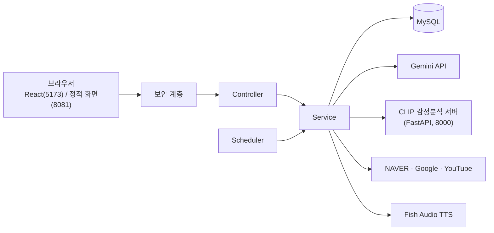

# Lumi(개인 비서)

감정을 읽고, 놓친 일정을 먼저 짚어주고, 개인 데이터를 안전하게 지키는 **개인 AI 비서**입니다.
동양미래대학교 컴퓨터소프트웨어공학과 「인공지능프로젝트」(2026년 2학기) 개별 프로젝트이며, 「정보보안개론」에서 배운 보안 원칙을 실제 서비스에 적용했습니다.

## 왜 만들었나

| 겪은 불편 | Lumi의 해결 |
| --- | --- |
| 일정이 겹치는 걸 마감 직전에야 발견 | 일정을 등록할 때 겹침을 계산해서 먼저 알려줌 |
| 일정·메모·검색이 여러 앱에 흩어짐 | 한 화면에서 대화로 조회·등록·검색 |
| 코딩 중 검색하느라 흐름이 끊김 | 대화창에서 바로 검색 결과를 요약해서 받음 |
| 기존 음성 비서가 기계적임 | 위트 있는 친구 말투, 감정에 맞춰 톤 조절 |
| 개인 프로젝트는 보안이 뒷전 | 인증·입력 검증·AI 특유의 위협 대응을 설계에 포함 |
| 갑작스러운 교통 정체와 대중교통 지연 때문에 등굣길에 지각함 (택시를 타고도 늦거나, 지하철을 여러 번 갈아타고 돌아간 적이 있음) | 묻거나 검색하지 않아도 일정·리마인더를 기준으로 Lumi가 먼저 말을 거는 선제 알림으로 해결 (현재 구현). 등교 시간에 맞춘 교통·대중교통 지연 정보 연동은 확장 목표 |

## 주요 기능

- **감정 인식 대화**: Gemini가 친구 같은 말투로 대화하고, CLIP이 메시지(또는 첨부 사진)의 감정을 분석해 답변 톤을 조절합니다. 대화 내용은 저장하지 않고 감정 수치만 기록합니다.
- **Function Calling 도구 9개**: 일정 조회·등록(겹침 감지), 리마인더 조회·등록, 노트 저장·삭제, 네이버 웹 검색, 구글 검색, 유튜브 검색
- **선제 알림**: 1분마다 임박한 일정·리마인더를 확인해 Lumi가 먼저 말을 겁니다.
- **음성 대화**: 브라우저 음성 인식(STT)과 Fish Audio 음성 출력(TTS). 실패하면 브라우저 음성합성으로 자동 대체합니다.
- **답변 교차 검증**: 사용자가 요청할 때만, 직전 답변을 네이버/구글 검색 결과와 대조합니다.
- **설정**: 입력 언어, AI 답변 언어, 음성 성별
- **대시보드**: Gemini 7일 사용량, 7일 감정 추이, 일정·리마인더·메모 패널, 보안 상태

## 시스템 구조



## 기술 스택

| 구분 | 기술 |
| --- | --- |
| 백엔드 | Java 21, Spring Boot 4, Spring Security, Spring Data JPA, Gradle |
| 프론트엔드 | React 19, Vite, Three.js (3D 뉴런 코어) |
| 데이터베이스 | MySQL |
| AI | Gemini API(대화·Function Calling), CLIP ViT-B/32(감정 분석, Python FastAPI) |
| 외부 서비스 | NAVER 검색, Google 검색, YouTube Data API, Fish Audio TTS, Google OAuth2 |

## 실행 방법

### 1. 준비물

- JDK 21, Node.js, MySQL
- (선택) 감정 분석을 쓰려면 CLIP 서버(Python)가 필요합니다. 없으면 감정 분석만 건너뜁니다.

### 2. 데이터베이스

```sql
CREATE DATABASE lumi_database CHARACTER SET utf8mb4;
```

테이블은 서버를 처음 실행할 때 자동으로 만들어집니다.

### 3. 환경변수

비밀값은 **코드에 넣지 않고 환경변수로만** 설정합니다. 실제 값을 저장소에 올리지 마세요.

| 환경변수 | 필수 | 설명 |
| --- | --- | --- |
| `GEMINI_API_KEY` | 필수 | Gemini API 키 |
| `DB_PASSWORD` | 필수 | MySQL 비밀번호 |
| `NAVER_CLIENT_ID`, `NAVER_CLIENT_SECRET` | 선택 | 네이버 웹 검색 (없으면 해당 검색 기능만 비활성) |
| `YOUTUBE_API_KEY` | 선택 | 유튜브 검색 |
| `FISH_API_KEY` | 선택 | Fish Audio TTS (없으면 브라우저 음성합성 사용) |
| `FISH_AUDIO_MODEL` | 선택 | 기본값 `s2.1-pro-free` |
| `FISH_AUDIO_VOICE_KO_MALE`, `..._KO_FEMALE`, `..._EN_MALE`, `..._EN_FEMALE` | 선택 | 언어·성별별 목소리 ID |
| `CLIP_SERVER_URL` | 선택 | 기본값 `http://localhost:8000` |
| 구글 OAuth 클라이언트 ID/시크릿 | 선택 | 구글 로그인용. `application.properties`의 해당 항목 이름을 확인해 같은 방식으로 설정 |

### 4. 실행

```bash
# 백엔드 (포트 8081)
./gradlew bootRun

# React 프론트엔드 (포트 5173, /api 요청을 8081로 전달)
cd lumi-frontend
npm install
npm run dev
```

- 정적 화면: http://localhost:8081
- React 화면: http://localhost:5173
- 시작할 때 `StartupDiagnostics`가 각 키 설정 여부와 CLIP 서버 연결 상태를 콘솔에 요약해 줍니다.

## API 목록

| 경로 | 설명 |
| --- | --- |
| `POST /api/chat`, `/api/chat/image`, `/api/chat/translate` | 대화, 사진 첨부 대화, 답변 번역 |
| `POST /api/cross-check` | 답변 교차 검증 |
| `GET /api/schedules`, `GET /api/reminders` | 일정·리마인더 조회 |
| `GET/POST/DELETE /api/notes` | 메모 |
| `GET /api/notifications/pending` | Lumi가 먼저 건넬 알림 |
| `GET/DELETE /api/emotions/...` | 감정 기록 조회·삭제 |
| `POST /api/tts` | 음성 변환 |
| `GET/POST /api/settings` | 사용자 설정 |
| `GET /api/usage` | Gemini 사용량 |
| `/api/auth/*` | 회원가입, 로그인, 내 정보, 로그인 기록 |
| `GET /api/security/status`, `/api/security/events` | 보안 상태와 이벤트 |

## 보안 설계

「정보보안개론」 주차별 내용을 구현에 연결했습니다.

| 영역 | 구현 |
| --- | --- |
| 인증·계정 | 로그인 필수, BCrypt 해시, 비밀번호 정책, 5회 연속 실패 시 15분 계정 잠금, IP당 5분 20회 실패 시 15분 차단, 구글 로그인 |
| 세션 | 30분 미사용 자동 로그아웃(최대 12시간), 다른 브라우저·IP에서 쓰이면 세션 폐기 |
| 웹 보안 | CSRF 토큰, 보안 응답 헤더(CSP 등), 웹 공격 패턴 탐지, 사용자별 데이터 분리 |
| 과다 요청 | IP별·사용자별 속도 제한, 동시 처리 한도, 요청 본문 크기 제한 |
| AI 보안 | 시스템 지침과 사용자 입력 분리, 프롬프트 인젝션 탐지와 반복 시 대화 제한, 시스템 지침 유출 답변 차단 |
| 사회공학 | 개인정보를 캐내려는 유도 질문 방어, 민감정보 마스킹, 로그아웃 시 서버 메모리의 대화 흔적 삭제 |
| 악성 링크·파일 | 검색 결과 링크 안전 검사, 업로드 이미지를 검증 후 서버가 다시 만들어 사용 |
| 추적 | 로그인 감사 로그, 보안 이벤트 기록·조회 |
| 개인정보 최소화 | 대화 내용은 DB에 저장하지 않음, 사진은 분석 후 폐기, 감정은 수치만 저장하고 90일 후 자동 삭제 |

## 폴더 구조

```
Lumi/
├─ src/main/java/com/jarvisst/Lumi/
│  ├─ controller/   API 진입점
│  ├─ service/      Gemini, 일정, 감정, 검색, TTS 등 핵심 로직
│  ├─ security/     인증, 필터, 입력 검증, 속도 제한 등 보안 계층
│  ├─ entity/       JPA 엔티티
│  ├─ repository/   DB 접근
│  ├─ scheduler/    선제 알림, 오래된 기록 삭제
│  └─ dto/          요청·응답 객체
├─ src/main/resources/
│  ├─ static/       정적 화면(HTML/CSS/JS)
│  └─ templates/    로그인·회원가입 화면
└─ lumi-frontend/   React 프론트엔드
```

## 개발 로드맵

| 시기 | 내용 |
| --- | --- |
| 10월 | 배포, HTTPS, 민감 컬럼 암호화 |
| 11월 초 | 실사용자 테스트(10명 이상), 만족도 설문(10문항 이상), 보안 수동 점검 |
| 11/16 | 코드 프리즈 |
| 11/18 | 중간발표 |
| 12/2 | 경진대회 |
| 선택 | 로컬 의도 분류기 평가·고도화와 섀도 모드 연동 |

## 한계

- 감정 분석은 텍스트·사진을 바탕으로 한 참고용 추정이며, 의학적 진단이 아닙니다.
- 생성형 AI의 답변은 틀릴 수 있어, 중요한 정보는 교차 검증 기능으로 확인해야 합니다.
- 개발 단계의 개인 비서 앱이며, 다수 사용자를 위한 운영 환경 검증은 아직 하지 않았습니다.

## 출처와 재사용

- 감정 분석 서버는 이전 프로젝트(Sync)에서 만든 CLIP 서버를 재사용했습니다.
- 모델·API: Gemini API, OpenAI CLIP, Fish Audio, NAVER·Google·YouTube Open API
